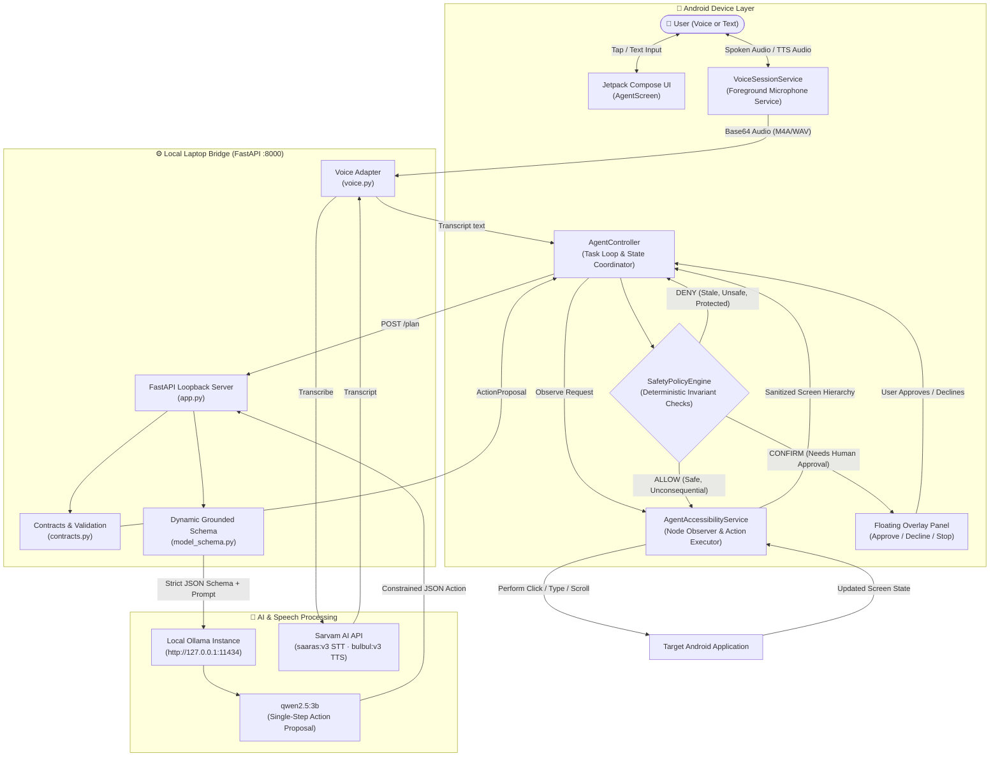
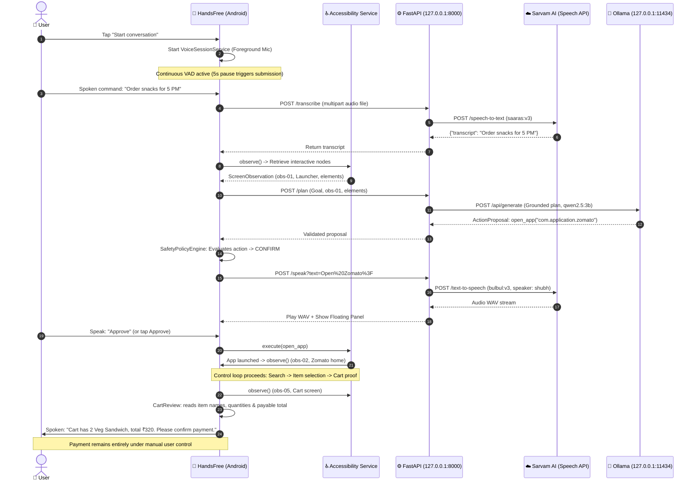
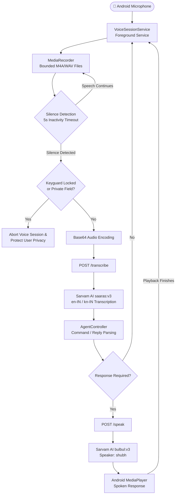

<div align="center">


# HandsFree AI

### A little help. Your way.

**Tell your phone what you need. Stay in control of what happens next.**

*An autonomous Android accessibility agent that translates spoken or typed intentions into grounded, multi-step actions across everyday mobile apps — asking for your approval before every consequential step.*

[](https://developer.android.com/)
[](https://developer.android.com/jetpack/compose)
[](https://ollama.com/library/qwen2.5)
[](https://fastapi.tiangolo.com/)
[-00897B?style=for-the-badge)](https://www.sarvam.ai/)
[](https://ollama.com/)

[The Problem](#-the-problem) · [What It Does](#-what-handsfree-ai-does) · [Main Features](#-main-features) · [System Architecture](#-system-architecture) · [How It Works](#-how-it-works) · [Tech Stack](#-technology-stack) · [Getting Started](#-getting-started) · [API Reference](#-api-endpoints-reference) · [Status](#-current-implementation-status) · [Safety & Privacy](#-safety-and-privacy)
**Team Trojan Trio** · Sapthagiri NPS University
</div>

---

## 🌍 The Problem

Modern smartphones are built on the implicit assumption that the user can physically tap, swipe, and type. For individuals experiencing motor impairments, temporary hand injuries, situational limitations (e.g., cooking, carrying groceries, driving), or visual accessibility challenges, this assumption transforms ordinary digital tasks into significant daily barriers.

Traditional voice assistants only address single-shot, rigid voice commands (such as *"set a timer for 10 minutes"* or *"what is the weather"*). They fall short when handling real-world, multi-step workflows across third-party applications (such as comparing lunch options, selecting items, managing a cart, or navigating complex settings screens). Furthermore, most cloud-centric commercial assistants transmit continuous screen frames, personal data, and audio streams to remote servers without granular user consent.

### Core Objectives
1. **Accessibility First:** Provide a truly hands-free, conversational interface to operate real Android applications through Android's native `AccessibilityService`.
2. **Local-First AI Reasoning:** Ground action planning on local models (Gemma via Ollama) so screen trees never travel to a third-party reasoning cloud.
3. **Deterministic Safety:** Enforce deterministic Android-side validation rules. The AI only *proposes* actions; the device runtime rigorously validates and gates every consequential operation with human consent.
4. **Multilingual Inclusivity:** Support natural speech and UI interactions in Indian languages (starting with English and Kannada, with Hindi planned), acknowledging regional linguistic diversity.
5. **Zero Financial Delegation:** Strictly forbid autonomous financial transactions. The agent reads cart totals and handshakes payment over to the user.

---

## 💡 What HandsFree AI Does

HandsFree AI acts as an intelligent, accessibility-focused bridge between spoken human intentions and deterministic mobile OS actions. It reads on-screen interface elements, consults a local Gemma model to determine the next logical action, subjects that proposal to rigid safety policies, and prompts the user for spoken or tapped authorization.

<table>
<tr>
<td width="50%">

### 🎙️ Speak Once to Begin
Start a conversation once. Speak requests, answer clarification questions, and grant approvals hands-free. The system features continuous voice capture with automated voice activity detection (VAD). Manual text input always remains available.

</td>
<td width="50%">

### 🥗 Choose What You Actually Want
Broad requests (e.g., *"order some snacks for 5 PM"*) initiate an intake dialogue about food category, budget, dietary restrictions, quantity, and delivery timing. HandsFree never assumes a default dish, restaurant, or budget.

</td>
</tr>
<tr>
<td>

### 📱 Real Third-Party App Navigation
Discovers real installed applications on the phone, launches them via explicit Android Intents, sanitizes their accessibility node hierarchy, and executes verified taps, text entry, scrolling, and navigation.

</td>
<td>

### 🛡️ Human-in-the-Loop Authority
Consequential actions (app switching, text typing, cart verification) require explicit confirmation. Password and authentication fields immediately abort voice capture. Payment authorization is strictly manual.

</td>
</tr>
</table>

> **Development MVP Notice:** Physical Android app execution, accessibility control loops, and local Gemma reasoning via Ollama are fully functional. Full third-party food-to-cart automation and hands-free voice acceptance are continually being validated on physical hardware. See the [Product and Release Plan](PRODUCT.md), [Privacy Policy](PRIVACY.md), and [Security Policy](SECURITY.md).

---

## ✨ Main Features

- **Continuous Hands-Free Voice Session:** Runs as a dedicated Android foreground service (`VoiceSessionService`) with `foregroundServiceType="microphone"`. Bounded audio segments are captured with a 5-second silence detection window, enabling natural dialogue without repeated wake-word prompts.
- **Dynamic Element-Grounded Schema:** Every planning request compiles a customized JSON schema directly constrained to the IDs and actions of elements currently visible on screen. Gemma is syntactically prevented from hallucinating non-existent UI buttons or package names.
- **Bi-Directional Multilingual Speech:** Integrated with Sarvam AI's Indian-language foundation models (`saaras:v3` for Speech-to-Text and `bulbul:v3` for natural Text-to-Speech), offering full support for Indian English (`en-IN`) and Kannada (`kn-IN`).
- **Interactive Floating Overlay:** An accessible, high-contrast floating overlay panel displays real-time status (`observing`, `planning`, `verifying`, `waiting for user`), reads prompts aloud, and provides immediate **Approve**, **Decline**, and **Stop** controls.
- **Structured Food Intake Engine:** Built-in conversational intake for food ordering tasks that systematically clarifies dish preferences, budget limits, dietary preferences, portions, and timing before opening food delivery apps (e.g., Zomato, Swiggy).
- **Cart Proof & Payable Total Verification:** Verifies actual displayed cart items, item counts, and unambiguous labeled totals (`Grand total`, `To pay`) before asking the user to confirm the cart and complete payment manually.
- **Strict Privacy & Anti-Hallucination Invariants:** Screens containing password, PIN, CVV, OTP, or sensitive accessibility flags are automatically excluded from model reasoning and terminate the voice capture loop immediately.

---

## 🏗️ System Architecture

HandsFree AI adopts a hybrid, local-first architecture. The Android application connects over a local loopback bridge (via USB `adb reverse tcp:8000 tcp:8000`) to a lightweight FastAPI server running locally on the user's computer.



---

## 🔁 How It Works

HandsFree AI operates in a closed **Observe → Reason → Act → Verify → Repeat** control loop.

<div align="center">

</div>

1. **Observe:** When a task begins, `AgentAccessibilityService` inspects the active application window. It extracts visible, interactive controls (IDs, text labels, roles, and allowed actions such as `click`, `type_text`, `scroll`), assigning a cryptographic observation fingerprint (`observation_id`). Protected inputs (passwords, PINs, OTPs) are filtered out immediately.
2. **Reason:** The filtered screen elements, task goal, user constraints, and recent action receipts are posted to `/plan`. The backend grounds actions in the supplied screen element IDs. Qwen 2.5 proposes **one next action**.
3. **Validate:** `SafetyPolicyEngine` evaluates the proposal on Android:
   - *Stale Check:* If the user or app shifted the screen during model inference (`action.observationId != currentScreen.id`), the action is rejected and the screen is re-observed.
   - *Scope Check:* The application package must belong to approved task packages.
   - *Protected Check:* Taps or text entries targeting payment or authentication controls are rejected.
4. **Approve (Act):** If the action is consequential (opening an app, typing text, confirming a cart), the floating overlay and voice service present the action reason and ask the user to say *"Approve"* or *"Decline"*. Once approved, Android accessibility APIs dispatch the click or input.
5. **Verify:** The controller waits for the screen to settle, captures a fresh observation, verifies that the state transitioned as expected (or that the target package opened), and proceeds to the next step until `finish_task` or `stop_task` is reached.

---

## 📡 Android and Backend Communication Flow

All mobile-to-laptop communication is routed across a secured ADB reverse proxy (`tcp:8000 -> tcp:8000`), maintaining full network isolation without exposing backend ports to the local Wi-Fi network.



---

## 🎙️ Voice Processing Workflow



### Voice Execution Rules
- **Microphone Foreground Service:** Uses `VoiceSessionService` with Android's `RECORD_AUDIO` and `FOREGROUND_SERVICE_MICROPHONE` permissions. A persistent notification confirms active listening to the user.
- **Dynamic VAD Window:** A 5-second silence window automatically submits audio for transcription. Speaking before the countdown expires resets the window.
- **Playback Interruption:** Audio recording automatically pauses during assistant speech playback to prevent self-transcription loops.
- **Privacy Lock & Field Guard:** If the phone's lock screen activates (`KeyguardManager.isKeyguardLocked`) or an accessibility node with `isPassword == true` is rendered, the voice capture session terminates instantly.

---

## 🧰 Technology Stack

| Layer | Technology | Details / Role |
|---|---|---|
| **Android Application** | Kotlin 2.0 / SDK 37 | Native Android mobile application |
| **UI Framework** | Jetpack Compose & Material 3 | Modern, declarative, accessible user interface |
| **Accessibility Engine** | Android `AccessibilityService` | Real-time screen tree inspection and node-level actions |
| **Networking (Mobile)** | OkHttp 4.12.0 & Coroutines | Resilient asynchronous HTTP client with timeout management |
| **Local Bridge Server** | FastAPI 0.115+ & Uvicorn | Async Python loopback server (`127.0.0.1:8000`) |
| **Data Contracts** | Pydantic v2 (Strict Mode) | Bounded, strongly-typed wire request/response validation |
| **Local Reasoning AI** | qwen2.5:3b via Ollama | Local reasoning model running at zero external API cost |
| **Speech-to-Text (STT)** | Sarvam AI (`saaras:v3`) | Low-latency Indian English (`en-IN`) and Kannada (`kn-IN`) ASR |
| **Text-to-Speech (TTS)** | Sarvam AI (`bulbul:v3`) | Natural speech synthesis (`shubh` voice model) |
| **Testing Frameworks** | Pytest, JUnit 4, Compose UI Test | Automated contract, schema, safety policy, and UI tests |

---

## 📱 Android Application Architecture

The Android application is organized into specialized, decoupled modules under `com.example.handsfree`:

```
com.example.handsfree/
├── MainActivity.kt               # Single-activity container with edge-to-edge Compose layout
├── accessibility/
│   ├── AgentAccessibilityService.kt  # Reads active application windows, builds ScreenObservation, dispatches actions
│   ├── ScreenObservation.kt     # Data structures for sanitized screen elements, roles, and bounding boxes
│   └── ServiceConnection.kt     # Observable connection state between service and Compose UI
├── agent/
│   ├── AgentController.kt       # Master state machine managing Observe-Reason-Act loop and user consent
│   ├── VoiceController.kt       # Manages MediaRecorder, MediaPlayer, and continuous voice turns
│   ├── VoiceSessionService.kt   # Android foreground service holding microphone lifecycle
│   ├── SafetyPolicyEngine.kt    # Deterministic rule evaluator (ALLOW, CONFIRM, DENY)
│   ├── CartReview.kt            # Validates food cart items, quantities, and labeled payable totals
│   ├── FoodIntake.kt            # Clarification engine for meal, diet, budget, portion, and timing preferences
│   ├── BackendClient.kt         # OkHttp client communicating with the FastAPI loopback bridge
│   ├── CompletionVerifier.kt    # Independent verification of goal completion against screen evidence
│   └── ActionMemory.kt          # Compact action history and receipt tracker
├── apps/
│   ├── AppDiscoveryManager.kt   # Discovers launchable packages via PackageManager
│   └── LaunchableApp.kt         # Holds app names, package identifiers, and system icons
└── ui/
    ├── AgentScreen.kt           # Conversational feed, status banners, language toggles, and floating controls
    ├── AppLanguage.kt           # Runtime language switching (English / Kannada)
    └── theme/                   # Material 3 typography, color palette, and shapes
```

---

## ⚙️ Backend Architecture

The backend operates strictly on `127.0.0.1:8000`. It acts as an intelligent proxy between Android and local/cloud AI capabilities.

1. **Local Concurrency Control:** Gemma reasoning requests are synchronized via an `asyncio.Lock()`. If an inference request is already processing, additional concurrent requests receive HTTP 429 rather than overloading the GPU/CPU.
2. **Payload Size Guard:** Middleware enforces strict content-length limits (750 KB for screen trees; 3 MB for voice audio payloads) to prevent memory exhaustion.
3. **Client Disconnect Cancellation:** If Android cancels a task or the user taps **Stop**, the in-flight HTTP connection terminates, immediately cancelling the background Ollama generation task.
4. **Credential Isolation:** The `SARVAM_API_KEY` is loaded from `.env.local` into server process memory. Keys are never transmitted to the mobile client or logged.

---

## 🧠 Ollama and Gemma Integration

HandsFree AI uses **qwen2.5:3b** hosted locally through [Ollama](https://ollama.com).

### Dynamic Schema Grounding (`model_schema.py`)
To prevent hallucinations, HandsFree AI generates an action-specific JSON schema on every reasoning step:
- **`observation_id` Constraint:** The schema enforces `{"const": request.observation_id}`. If the model attempts to generate an action for a previous screen, it fails schema validation.
- **Target Grounding:** `target_id` is defined as `{"enum": [valid_screen_node_ids]}`. The model cannot click or type into elements that do not exist.
- **Calculator Key Enforcement:** For calculator packages (`com.oneplus.calculator`, `com.google.android.calculator`), `type_text` is dynamically removed from allowed actions. The model is forced to click visible on-screen keypad buttons, ensuring the native calculator engine computes expressions correctly.

---

## 🇮🇳 Sarvam AI Integration

HandsFree AI integrates with [Sarvam AI](https://www.sarvam.ai/) to deliver low-latency, natural voice interactions in Indian languages:

- **Speech-to-Text (`POST /transcribe`):**
  - Model: `saaras:v3`
  - Mode: `transcribe`
  - Supported Languages: Indian English (`en-IN`) and Kannada (`kn-IN`)
- **Text-to-Speech (`POST /speak?text=...`):**
  - Model: `bulbul:v3`
  - Speaker: `shubh`
  - Output Audio Codec: `wav`
- **Graceful Fallback:** If `SARVAM_API_KEY` is omitted, voice endpoints return HTTP 503 with a clear JSON error. `/health` and `/plan` remain available.

---

## 📋 Prerequisites

| Component | Minimum Requirement | Notes |
|---|---|---|
| **Development Laptop** | Windows 10/11 | Host machine for backend and model execution |
| **Python** | Python 3.12+ | Required for FastAPI backend |
| **Local LLM Runner** | [Ollama](https://ollama.com) | Running locally on `http://127.0.0.1:11434` |
| **Model** | `qwen2.5:3b` | Pulled in Ollama (`ollama pull qwen2.5:3b`) |
| **Android Tools** | Android SDK 37, Platform-Tools | `adb.exe` in `LOCALAPPDATA` |
| **Java Development Kit** | JDK 17+ or Android Studio JBR | Builds verified with JBR 25 |
| **Physical Android Device** | Android 14+ (API 34/37) | USB debugging enabled; connected via USB data cable |
| **Voice Credentials** | Sarvam AI API Key *(Optional)* | Required for voice STT/TTS; text mode works without it |

---

## 🚀 Complete Installation Instructions

### Step 1: Clone and Set Up the Python Backend

```powershell
# Clone the repository
git clone https://github.com/kkoushik24/handsfree-AI.git
cd handsfree-AI

# Create and activate Python virtual environment
python -m venv .venv
.\.venv\Scripts\activate

# Install backend dependencies
pip install -r backend\requirements.txt
```

### Step 2: Configure Environment Variables

Copy the example template to `.env`:

```powershell
Copy-Item .env.example .env
```

Edit `.env` to configure your settings:

```ini
# Optional Sarvam AI key for Kannada and English voice
SARVAM_API_KEY=

# Local Ollama endpoint and model configuration
OLLAMA_HOST=http://127.0.0.1:11434
OLLAMA_MODEL=qwen2.5:3b
OLLAMA_TIMEOUT=120
```

> [!NOTE]
> Environment priority: Process environment variables, then `.env`. `.env` and `.env.local` are ignored by Git. Keep the Sarvam key on the backend only.

### Step 3: Pull the Reasoning Model

Ensure Ollama is installed and running, then pull the planner model:

```powershell
ollama pull qwen2.5:3b
ollama list
```

---

## ⚡ Backend Startup Instructions

### Automated Startup (Recommended)

Connect your unlocked Android device via USB and run the automated launcher:

```powershell
.\Start-HandsFree.bat
```

Alternatively, invoke the underlying PowerShell script:

```powershell
powershell -NoProfile -ExecutionPolicy Bypass -File scripts\start-local.ps1 -OpenApp
```

The script automatically:
1. Verifies or launches local Ollama on port `11434`.
2. Starts the FastAPI backend on port `8000`.
3. Verifies that `qwen2.5:3b` is loaded and ready.
4. Executes `adb reverse tcp:8000 tcp:8000` over your USB connection.
5. Launches HandsFree AI directly on your phone.

### Manual Backend Launch (from the repository root)

```powershell
uvicorn backend.app:app --reload --host 0.0.0.0 --port 8000
```

| Service | Local Address | Description |
|---|---|---|
| **Android Bridge API** | `http://127.0.0.1:8000` | FastAPI root |
| **Health Check** | `http://127.0.0.1:8000/health` | Service and Ollama model readiness |
| **Interactive API Docs**| `http://127.0.0.1:8000/docs` | Swagger UI documentation |
| **Ollama Core API** | `http://127.0.0.1:11434` | Raw Ollama daemon |

---

## 📲 Android Installation and Setup

### 1. Build and Install Debug APK

Connect your phone with USB debugging enabled:

```powershell
# Set Java environment (adjust to your Android Studio JBR path if necessary)
$env:JAVA_HOME = "C:\Program Files\Android\Android Studio\jbr"

# Build debug APK
.\gradlew.bat :app:assembleDebug --no-daemon

# Reverse port 8000 so phone can reach laptop localhost
adb reverse tcp:8000 tcp:8000

# Install APK onto connected device
adb install -r app\build\outputs\apk\debug\app-debug.apk
```

### 2. Enable Accessibility Service

1. Open **HandsFree AI → Settings → Screen access settings → Open settings**.
2. Navigate to **Accessibility → Downloaded apps / Installed services → HandsFree AI**.
3. Toggle the switch **On** and accept Android's confirmation prompt.
4. Return to the app and confirm that **Screen access is on**.

> [!IMPORTANT]
> **Android 13+ Restricted Settings:** If Android greys out the accessibility toggle with *"Restricted setting"*, open **Phone Settings → Apps → HandsFree AI → Tap the three dots (top right) → Allow restricted settings**, then return to Accessibility settings to enable it.

---

## 🎮 How to Use the Application

1. **Launch the App:** Open HandsFree AI. Verify the status banner says `Laptop connected · qwen2.5:3b`.
2. **Select Language:** Use the **English / ಕನ್ನಡ** toggle on the home screen to set your preferred voice and UI language.
3. **Start Conversation:** Tap **Start conversation**. Grant microphone permissions if prompted.
4. **Speak Your Request:** Speak naturally. When you pause for 5 seconds, your speech is automatically transcribed and sent for planning.
5. **Approve Actions:** When the assistant proposes an action, review the floating prompt or listen to the spoken explanation. Say **"Approve"** or tap **Approve** to proceed; say **"Decline"** to cancel.

### Spoken and On-Screen Commands

| Command | Action Performed |
|---|---|
| **"New task"** / **"Start over"** | Cancels the active task, clears context, and keeps voice listening ready |
| **"Home"** | Clears task and returns to HandsFree AI home screen |
| **"Phone home"** | Clears task and navigates to the Android launcher |
| **"Stop conversation"** / **"Stop"** | Immediately cancels all execution and releases the microphone |
| **"Approve"** / **"Yes"** | Authorizes the currently pending action proposal |
| **"Decline"** / **"No"** | Rejects the proposed action and prompts for clarification |

---

## 💬 Example Conversation Walkthrough

### Scenario: *"I want to order some snacks for 5 PM"*

```
User: 🎙️ "I want to order some snacks for 5 PM."

HandsFree: 🗣️ "Which food app do you prefer: Swiggy or Zomato?"
[Displays candidate app cards on screen]

User: 🎙️ "Zomato."

HandsFree: 🗣️ "Let's use Zomato. What kind of snacks are you looking for?"
[Opens Zomato in foreground]

User: 🎙️ "Veg sandwiches or samosas, under 300 rupees for two people."

HandsFree: 🗣️ "Got it. Searching for veg sandwiches in Zomato."
[Navigates to search, types query, and observes results]

HandsFree: 🗣️ "Found 'Veg Grilled Sandwich' for ₹140. Should I add 2 to your cart?"
[Presents approval card on floating overlay]

User: 🎙️ "Approve."
[Clicks Add twice, opens cart]

HandsFree: 🗣️ "Your cart contains 2 x Veg Grilled Sandwich. Labeled payable total is ₹320.50. Please confirm payment."
[Hands off to user before payment authorization]
```

---

## 🔌 API Endpoints Reference

The current backend request and response shapes, action examples, and offline mock sample are documented in [`docs/api_contract.md`](docs/api_contract.md).

### 1. `GET /health`
Verifies backend connectivity and service configuration.

**Response (200 OK):**
```json
{
  "status": "ok",
  "model": "qwen2.5:3b",
  "ollama_reachable": true,
  "model_ready": true
}
```

---

### 2. `POST /plan`
Accepts the goal and visible screen elements and returns one grounded next action. See [`docs/api_contract.md`](docs/api_contract.md) for request and response JSON, action examples, and the offline mock response.

### 3. `POST /speak?text=...`
Synthesizes text to WAV audio via Sarvam AI. With no `SARVAM_API_KEY`, returns HTTP 503 and `{"error":"voice disabled: SARVAM_API_KEY not set"}`.

### 4. `POST /transcribe`
Accepts a multipart `file` upload and returns `{"text":"recognized words"}`. With no key, returns the same HTTP 503 JSON error as `/speak`.

---

## 🧪 Testing and Verification

HandsFree AI enforces high test coverage across both Android and Python layers.

### Run Android Unit Tests and Lint

```powershell
$env:JAVA_HOME = "C:\Program Files\Android\Android Studio\jbr"
.\gradlew.bat :app:testDebugUnitTest :app:lintDebug --no-daemon
```

- **`SafetyPolicyTest.kt`:** Verifies deterministic rejection of stale observation IDs, ungrounded actions, protected password/payment inputs, and enforcement of consent.
- **`FoodIntakeTest.kt`:** Validates questionnaire flow, ensures no default dishes are invented, and verifies app candidates.
- **`CartReviewTest.kt`:** Tests strict payable total matching, quantity checks, and rejection of ambiguous subtotals.
- **`ConversationCommandTest.kt`:** Verifies command parsing for Stop, Home, and Start Over.

### Run Backend Pytest Suite

```powershell
$env:PYTEST_DISABLE_PLUGIN_AUTOLOAD = "1"
.\.venv\Scripts\python.exe -m pytest backend/tests -q
```

- **`test_contracts.py`:** Validates wire contracts, bounding constraints, and rejects invalid action proposals.
- **`test_schema.py`:** Verifies dynamic schema generation, `observation_id` binding, and target ID enums.
- **`test_voice.py`:** Tests Sarvam adapter handling, language code validation, and fallback mechanisms.

---

## 📁 Project Folder Structure

```text
handsfree-AI/
├── app/                              # Android client application
│   ├── build.gradle.kts              # Application build config (SDK 37, Compose)
│   └── src/
│       ├── main/
│       │   ├── AndroidManifest.xml   # Permissions, foreground services, accessibility service
│       │   ├── java/com/example/handsfree/
│       │   │   ├── MainActivity.kt   # Root Compose activity
│       │   │   ├── accessibility/    # Screen observation & node action dispatch
│       │   │   ├── agent/            # Task controller, safety engine, voice controller
│       │   │   ├── apps/             # App discovery and launch helpers
│       │   │   └── ui/               # Compose screens, components, and language logic
│       │   └── res/                  # Drawables, layouts, strings, and localizations
│       ├── test/                     # Android JVM unit tests
│       └── androidTest/              # Device instrumentation tests
├── backend/                          # FastAPI local bridge server
│   ├── app.py                        # FastAPI routes, concurrency lock, Ollama proxy
│   ├── contracts.py                  # Strict Pydantic models and proposal validation
│   ├── model_schema.py               # Grounded JSON schema generator for Gemma
│   ├── voice.py                      # Sarvam AI STT & TTS integration
│   ├── run.py                        # Uvicorn entry point loading .env.local
│   ├── requirements.txt              # Python dependencies
│   └── tests/                        # Backend test suite (contracts, schema, voice)
├── scripts/                          # Automation scripts
│   └── start-local.ps1               # PowerShell startup, health verification, and ADB reverse
├── assets/                           # Visual graphics and animations
│   └── agent-loop.svg                # Observe-Reason-Act loop diagram
├── Start-HandsFree.bat               # One-click Windows development launcher
├── HandsFree_AI_Logo.png             # Official project logo
├── PRODUCT.md                        # Product requirements and release milestones
├── PRIVACY.md                        # Data handling, privacy, and sensitive input rules
├── SECURITY.md                       # Security policy and reporting process
├── CONTRIBUTING.md                   # Contribution workflow and guidelines
├── .env.example                      # Configuration template (no secrets)
└── README.md                         # Project documentation
```

---

## 📊 Current Implementation Status

| Feature / Domain | Status | Evidence / Verification Boundary |
|---|---|---|
| **App Discovery & Launch** | ✅ Implemented | Exercised and verified on physical OnePlus device via `PackageManager` |
| **Accessibility Observation** | ✅ Implemented | Screen trees sanitized, bounding boxes resolved, and node actions executed |
| **Local Gemma Reasoning** | ✅ Implemented | Real structured JSON output generated via Ollama with schema constraints |
| **Deterministic Safety Engine** | ✅ Implemented | Rejects stale hashes, enforces consent, stops on password/OTP fields |
| **Food Intake Clarification** | ✅ Implemented | Multi-turn preference gathering (diet, budget, quantity, timing) |
| **Home & Session Reset** | ✅ Implemented | Voice commands ("New task", "Home", "Stop") reset state machine |
| **Multilingual Voice Toggle** | ✅ Implemented | Runtime switching between English (`en-IN`) and Kannada (`kn-IN`) |
| **Cart Proof Verification** | 🟡 Partially Implemented | Labeled total verification implemented; physical food app edge-cases ongoing |
| **Continuous Voice Turn Acceptance** | 🟡 Partially Implemented | Foreground mic service operational; full conversational edge cases in progress |
| **Calculator Arithmetic** | 🟡 Partially Implemented | Keypad clicking verified; complex multi-operation parsing ongoing |
| **Phone-Only Native Inference** | ⏳ Planned | Architecture designed in [PRODUCT.md](PRODUCT.md) using LiteRT-LM runtime |

---

## ⚠️ Known Limitations

<details>
<summary><strong>Click to expand technical limitations</strong></summary>

- **Local CPU/GPU Inference Latency:** Running Gemma locally on general-purpose laptops may take 10 to 30 seconds per reasoning turn. Real-time sub-second planning is not claimed.
- **Dynamic Third-Party UI Changes:** Pop-up banners, keyboard transitions, or splash screens invalidate screen fingerprints, prompting immediate re-observation and replanning.
- **Food Delivery Application Scope:** App-specific intake heuristics currently target Zomato and Swiggy. Universal compatibility across all food platforms is not guaranteed.
- **Explicit Cart Total Visibility:** The assistant cannot calculate or assume delivery fees, taxes, or discounts. The final payable total must be explicitly displayed on-screen.
- **Missing App Store Guidance:** If an app is missing, HandsFree opens the Play Store listing. Installation must be approved and completed manually by the user.
- **In-Memory Task Persistence:** Task states reside in memory. Process termination or OS activity recreation requires starting a fresh session.
- **Localhost Development Boundary:** The debug loopback bridge is strictly disabled in production release builds.

</details>

---

## 🛡️ Safety and Privacy

### Safety by Design
- **Freshness Invariant:** Every action proposal is cryptographically bound to an `observation_id`. If the screen shifts, the action is discarded.
- **Explicit Human Approval:** Consequential actions (launching applications, typing queries, approving cart items) require affirmative user confirmation.
- **Private Data Protection:** Fields marked with `isPassword`, containing authentication keywords (`otp`, `cvv`, `passcode`), or flagged sensitive by Android are excluded from observations. If detected during a task, voice capture terminates immediately.
- **Financial Boundary:** HandsFree AI never clicks *"Place Order"*, *"Pay Now"*, or enters payment credentials. It reads the cart total and yields control to the user.
- **Immediate Stop:** An omnipresent **Stop** control remains visible and audible, allowing instantaneous task abort.

### Privacy Handling
- Screen hierarchies and reasoning queries stay strictly local on your laptop; no screen content is dispatched to cloud LLMs.
- When voice is enabled, bounded audio segments are processed via Sarvam AI under their standard privacy terms. Credentials stay securely on your laptop.
- Ephemeral audio files are stored in private app cache and cleared after processing.

---

## 🔮 Future Improvements & Roadmap

As outlined in [PRODUCT.md](PRODUCT.md), HandsFree AI is progressing through eight structured delivery stages:

- **Stage R0 (Foundation):** Open-source codebase, architecture specs, and baseline safety invariants *(Completed)*.
- **Stage R1 (Model Lifecycle):** Verified local model installation, health monitoring, and recovery *(Completed)*.
- **Stage R2 (Phone-Only Planner):** Port reasoning to an on-device native runtime using **LiteRT-LM**, eliminating the laptop requirement.
- **Stage R3 (Grounded Execution):** Advanced spatial recovery, ambiguous target disambiguation, and multi-window handling.
- **Stage R4 (Multilingual Expansion):** Physical acceptance of Hindi (`hi-IN`) alongside English and Kannada across voice and UI.
- **Stage R5 (Accessible UX):** 200% font scaling, comprehensive TalkBack screen reader verification, and physical user testing.
- **Stage R6 (Task Broadening):** Expansion beyond food ordering to messaging, calendar management, and system settings.
- **Stage R7 (Production Hardening):** Standalone signed release APK and formal Google Play Accessibility Policy compliance review.

---

## Acknowledgements

### Third-Party & Open Source Acknowledgements
- **[Qwen 2.5](https://ollama.com/library/qwen2.5):** Local reasoning model served through Ollama.
- **[Ollama](https://ollama.com):** Local LLM runner enabling fast offline model execution.
- **[Sarvam AI](https://www.sarvam.ai/):** Indic speech technology powering accurate English and Kannada voice recognition and synthesis.
- **[FastAPI](https://fastapi.tiangolo.com/):** High-performance Python web framework for local loopback coordination.
- **[Jetpack Compose](https://developer.android.com/jetpack/compose):** Declarative UI toolkit for modern Android development.
- **Design References:** Architectural settling concepts inspired by [AndroidWorld](https://github.com/google-research/android_world) and device tooling patterns from [Mobilerun](https://github.com/droidrun/mobilerun).

---

<div align="center">

**HandsFree AI — Technology that listens, so hands don't have to.**


</div>
