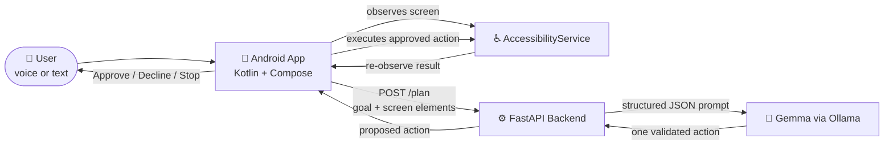

<div align="center">

# 🖐️ HandsFree AI

### Control your Android phone with your voice. Local-first. You stay in charge.

*An autonomous Android agent that turns spoken or typed goals into multi-step actions across your apps, and always asks before it acts.*


**Team Trojan Trio** · Sapthagiri NPS University

</div>

---

## 🌍 The Problem

Smartphones assume you can tap, swipe and type. For people with motor impairments, temporary injuries, or anyone whose hands are busy, that assumption turns everyday tasks into barriers.

Existing voice assistants handle one-line commands ("set an alarm"). They fall apart on real, multi-step tasks across different apps, and many send everything to the cloud.

## 💡 Our Solution

**HandsFree AI** understands a goal like *"Open settings and turn on dark mode"*, looks at what is actually on the screen, decides the next step, **asks for your approval**, performs it, then checks the result and continues until the goal is done.

| | |
|---|---|
| 🎙️ **Voice or text input** | Say it or type it. |
| 🧠 **Local AI planning** | Gemma runs on your own machine through Ollama. Your screen content is not sent to a cloud AI. |
| 👀 **Screen understanding** | Reads on-screen controls through Android's Accessibility Service. |
| ✅ **Approve every action** | You see each proposed action and can approve, decline or stop at any time. |
| 🔒 **Safety by design** | Passwords, OTPs and payments are always left to you. |
| 🔁 **Verify and continue** | After each step the app re-observes the screen before moving on. |

## 🏗️ Architecture



**The task loop**

1. User gives a goal.
2. App reads the available controls on screen.
3. Backend asks Gemma for **one** next action, forced into a strict JSON schema.
4. Backend validates it and applies safety rules.
5. App shows the action; the user approves or declines.
6. App executes it, re-observes the screen, and repeats until `done`.

## 🛡️ Safety Mechanisms

- **Human approval on every action.** Nothing runs without a tap from the user.
- **Visible Stop button.** The user can cancel the task at any moment.
- **Sensitive fields are off-limits.** Password, OTP and payment fields are flagged and the agent hands control back to the user.
- **Hallucination guard.** If the model picks a control that isn't on screen, the backend rejects it, retries once, then asks the user.
- **Stale action protection.** Each plan carries a `screen_hash`. If the screen changed, the action is discarded and the screen is re-observed.
- **Graceful failure.** If the model or backend is down, the app shows a clear message instead of crashing.

## 🧰 Tech Stack

| Layer | Technology |
|---|---|
| Mobile app | Kotlin, Jetpack Compose, Android AccessibilityService |
| Backend | Python, FastAPI, Pydantic, Uvicorn |
| AI model | Gemma (E2B) running locally through Ollama |
| Voice | Android speech recognition and TTS; ElevenLabs text-to-speech (optional, planned) |
| Testing | Pytest, integration and safety test suites |

## 📁 Repository Structure

```
handsfree-AI/
├── app/          # Android app (UI, app discovery, accessibility, task controller)
├── backend/      # FastAPI server, API contract, Gemma integration
│   ├── app.py            # routes: /health, /plan
│   ├── contracts.py      # typed request/response models
│   └── model_schema.py   # structured model output, validation, fallbacks
├── tests/        # integration and safety tests
└── docs/         # architecture, demo script, test reports
```

## 🚀 Getting Started

### Backend

**Prerequisites:** Python 3.10+, [Ollama](https://ollama.com) with a Gemma model pulled.

```bash
git clone https://github.com/kkoushik24/handsfree-AI.git
cd handsfree-AI/backend

python -m venv .venv
.venv\Scripts\activate          # Mac/Linux: source .venv/bin/activate
pip install fastapi uvicorn pydantic httpx pytest

# Use the exact model name from `ollama list`
set OLLAMA_MODEL=your-model-name        # PowerShell: $env:OLLAMA_MODEL="your-model-name"

uvicorn app:app --host 0.0.0.0 --port 8000 --reload
```

Then open:
- Health check: `http://localhost:8000/health`
- Interactive API docs: `http://localhost:8000/docs`

Test without the AI model by adding `?mock=true` to `/plan`.

### Android app

> Setup steps for the Android app will be added by the app owner.

Point the app at your laptop's address (`http://<laptop-ip>:8000`), or use `adb reverse tcp:8000 tcp:8000` over USB. Enable the app's Accessibility Service in Android settings.

## 🔌 API Reference

### `GET /health`
```json
{ "status": "ok", "model": "gemma...", "ollama_reachable": true, "model_ready": true }
```

### `POST /plan`

**Request**
```json
{
  "task_id": "t1",
  "step": 0,
  "goal": "Open settings",
  "app_package": "com.android.launcher",
  "screen_hash": "abc123",
  "elements": [
    { "id": "e1", "text": "Settings", "clickable": true },
    { "id": "e2", "text": "Password", "editable": true, "sensitive": true }
  ],
  "history": []
}
```

**Response**
```json
{
  "task_id": "t1",
  "step": 0,
  "screen_hash": "abc123",
  "action": {
    "type": "tap",
    "target_id": "e1",
    "text": null,
    "reason": "Tapping Settings to open it.",
    "needs_approval": true
  },
  "error": null
}
```

`action.type` is one of: `tap`, `type`, `scroll`, `back`, `open_app`, `ask_user`, `done`.

## 🎬 Demo

> 📹 Demo video: *link coming soon*

**Demo flow:** user speaks a goal → AI proposes an action → user approves → app executes → app verifies → task completes.

## 🗺️ Roadmap

- [x] API contract and FastAPI backend with health check
- [x] Mock planning endpoint for parallel development
- [ ] Gemma structured action generation with validation
- [ ] Voice input and spoken confirmations
- [ ] Full approve, execute and verify loop on a real device
- [ ] Fully on-device inference (no laptop needed)
- [ ] Support for more apps and longer multi-step tasks
- [ ] Multi-language voice support

## 👥 Team Trojan Trio

| Member | Role |
|---|---|
| **Yohaan G Oommen** | Team lead, Android app developer |
| **K Koushik** | AI and backend developer |
| **Yashwanth KN** | Integration, safety testing and demo lead |

Built at **Celestia 2026**, the 24-hour national hackathon hosted by HyprLAN at Rajarajeswari College of Engineering, Bengaluru.

## 📜 Open Source and Third-Party Credits

FastAPI, Pydantic, Uvicorn, HTTPX, Ollama, Gemma, Jetpack Compose, ElevenLabs (planned voice output). All project code was written by the team during the hackathon.

---

<div align="center">

**Technology that listens, so hands don't have to.**

</div>
